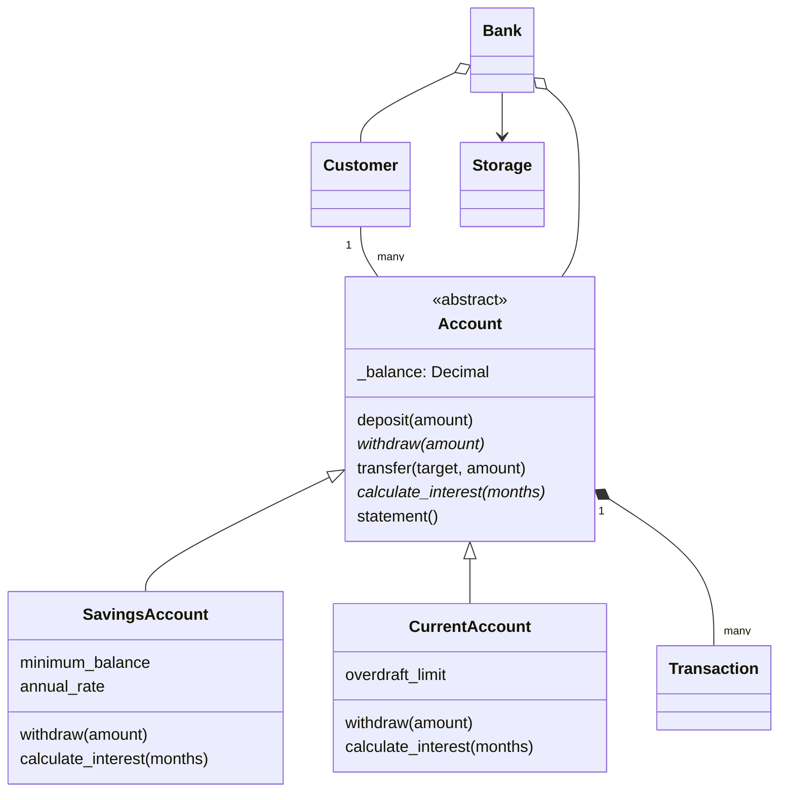

# Advanced Bank Management System Using OOP

A menu-driven Python terminal project demonstrating interview-level OOP through the banking features in the problem statement. The application uses only the Python standard library. No database, web framework or frontend is required.

## Objectives and scope

Create customers and savings/current accounts, deposit, withdraw, transfer funds, calculate interest, show/export statements and handle custom banking errors. The objective is to explain each course concept through working, readable code. Authentication, loans, cards and other banking products are outside this project.

## Installation and Windows VS Code commands

Install Python 3.12 or later and open this project folder in VS Code. In its PowerShell terminal:

```powershell
python --version
python main.py
python -m unittest discover -s tests -v
python tools/smoke_test.py
python -m compileall .
```

The application has no packages to install. To regenerate the presentation only:

```powershell
python -m pip install python-pptx==1.0.2
python tools/build_presentation.py
```

By default data lives beside main.py in `data/bank.txt`, independent of the terminal's working directory. To use a separate directory:

```powershell
python main.py --data-dir demo_data
```

No demo records appear automatically. The requested optional seed command is:

```powershell
python main.py --data-dir demo_data --demo-data
python main.py --data-dir demo_data
```

It requires an empty bank and creates one demo customer, savings S100 (1000.00) and current C100 (500.00). It exits after seeding. Keep demo and personal records separate.

## Menu and usage

```text
1 Create Customer          2 Open Savings Account
3 Open Current Account     4 Deposit
5 Withdraw                 6 Transfer Funds
7 Check Balance            8 Calculate Interest
9 Credit Interest         10 View Account Statement
11 Export Statement       12 View Customer Details
13 List Accounts          14 Exit
```

First create customer C1 with name Ravi, phone 9876543210 and email ravi@example.com. Open savings S1 with opening balance 1000, minimum 100 and annual rate 6. Open current A1 for C1 with balance 200 and overdraft 500. Transfer 100 from S1 to A1. Balance inquiry shows 900.00 and 300.00. Calculate 12 months of savings interest to see 54.00 without changing the balance. To credit it, choose option 9, enter a unique period label such as 2026 and type YES. Savings then holds 954.00. Reusing that label fails even after restarting.

Sample statement excerpt (IDs and timestamps vary):

```text
Account statement: S1
Customer: Ravi
Date | Transaction ID | Account | Type | Amount | Balance | Counterparty | Period
2026-11-16T10:00:00+00:00 | <unique ID> | S1 | TRANSFER_OUT | 100.00 | 900.00 | A1 |
Closing balance: 900.00
```

Statements include the opening entry and all subsequent entries. Export option 11 accepts an output TXT path and overwrites an existing export at that path. Invalid menu choices, customer fields, money and missing accounts show readable errors. Ctrl+C and EOF end the session gracefully. A damaged snapshot causes startup to stop without overwriting it.

## OOP concepts and architecture

| Course concept | Actual implementation |
| --- | --- |
| Classes and objects | Customer, Account subclasses, Bank and Transaction instances |
| Constructors | Customer validation and account policy initialization |
| Encapsulation | Protected `_balance`, public read-only balance and ledger properties |
| Inheritance | SavingsAccount and CurrentAccount inherit Account |
| Abstraction | Account extends ABC with abstract withdraw and calculate_interest |
| Polymorphism | Bank invokes the same methods on either account type |
| Method overriding | Each subclass implements its withdrawal and interest policies |
| Custom exceptions | BankingError hierarchy provides domain-specific failures |
| Basic modules | Separate customer, account, bank, ledger, storage and CLI modules |
| TXT file handling | pathlib, UTF-8 JSON snapshot, readable TXT exports |



The CLI collects input. Bank resolves IDs and coordinates persistence. Account subclasses enforce rules and append immutable Transaction records. Storage serializes the complete state. Use Bank methods for application operations so changes persist. Account methods alone demonstrate domain behavior in memory.

## Project tree

```text
.
├── main.py
├── bank.py
├── customer.py
├── account.py
├── savings_account.py
├── current_account.py
├── transaction.py
├── exceptions.py
├── storage.py
├── utils.py
├── README.md
├── .gitignore
├── data/
│   └── .gitkeep
├── tests/
│   └── test_banking.py
├── tools/
│   ├── smoke_test.py
│   └── build_presentation.py
└── presentation/
    └── Advanced_Bank_Management_System.pptx
```

## Money, account rules and interest assumptions

Money accepts strings, integers or Decimal, rejects float/bool, non-finite values, amounts outside ±999999999999.99 and values with nonzero fractions below a cent. Numerically exact trailing zeros such as 1.000 are accepted. Transaction amounts must be positive. Stored balances use two decimal places. All monetary arithmetic uses Decimal.

Savings opening balance must cover its configurable minimum (default 0.00), and withdrawals/transfers cannot cross it. Current accounts allow withdrawals down to the negative overdraft limit (default 1000.00). Opening balances through Bank cannot be negative. The rate defaults to 4.00% annually and accepts 0-100% with at most two decimal places.

Simple interest = current balance × annual percentage rate × whole months / 1200. Duration is 1-120 months. Round the result to cents using ROUND_HALF_UP. Current accounts return zero. Calculation never changes balances. Credit requires explicit confirmation and a positive result. Each account may credit a period label only once. The label is a user-supplied identifier, not a calendar engine: different labels may describe overlapping periods. This educational model does not calculate daily balances or automatically accrue interest. Choose labels consistently. Calculation uses the balance at the time of calculation/credit, not a historical period average.

## TXT persistence and consistency

`data/bank.txt` is a single readable UTF-8 JSON document, version 1, with customers and accounts arrays. Each account embeds its full transaction ledger and policy fields. Money uses decimal strings. IDs remain stable across restarts. A transfer has two entries sharing one transaction ID, opposite types and reciprocal counterparties. All other transaction IDs are unique. Timestamps use UTC with timezone information.

A mutation captures prior in-memory state, applies the operation, writes the whole state to a temporary file in the same directory, flushes/fsyncs it and uses os.replace to publish it atomically. A save failure rolls back balances and entries while preserving existing account object identities. Thus readers load either the previous snapshot or the complete new snapshot, including both sides of transfers. Temporary files do not become authoritative.

Startup validates format/version, customer fields, IDs, account rules, monetary fields, opening entries, running and closing ledger balances, transaction types, duplicate IDs, interest labels and matching transfer pairs. Corrupted data raises StorageError and remains untouched. Restore a known-good copy manually before restarting. Do not delete a damaged file unless its data is no longer needed.

This is a single-process educational snapshot design. There is no multi-process locking, encryption, tamper-proof audit trail, automatic backup, or production banking guarantee. Never run two app instances on the same directory. A full snapshot rewrite grows with history. Atomic replacement does not guarantee survival of every power-loss/filesystem failure. Retain external backups. TXT files contain customer data and should remain private.

## Custom exceptions

BankingError is the common base. InvalidAmountError rejects bad monetary inputs. InsufficientFundsError reports account policy breaches. AccountNotFoundError reports unknown accounts. DuplicateAccountError protects account numbers. ValidationError handles customer/configuration/interest validation. StorageError reports loading, saving and export failures.

## Verification

Run the unittest, CLI smoke and compile commands above. Tests use temporary directories and cover customer validation, both account types, abstraction, encapsulation, polymorphism, deposits, withdrawals, transfers, account limits, invalid amounts, interest confirmation/duplicates, persistence, statements, duplicate IDs, corrupted ledgers and rollback on disk failure. The CLI smoke exercises all 14 menu options, checks exported interest and verifies final balances after restart. No test writes real bank records.

## Limitations and future enhancements

The scope intentionally remains the problem statement. Authentication, concurrency, production audit/security and a database would require a separate future project, and are not implemented here. There are no scheduled interest jobs, fees, loan products or web screens.

## 20 interview questions and simple answers

1. **What is a class?** A definition of data and behavior, such as Customer.
2. **What is an object?** One instance of a class, such as savings account S1.
3. **What does __init__ do?** It initializes and validates a newly constructed account.
4. **What is encapsulation?** Keeping state behind a public interface, such as the read-only balance property.
5. **Is an underscore truly private?** No. It is Python's protected/internal-use convention.
6. **What is inheritance?** A subclass reuses behavior from a base class.
7. **Why use an abstract base class?** It defines the contract every account type must implement.
8. **Can Account be instantiated?** No, its abstract methods must be implemented first.
9. **What is polymorphism?** The same method call selects behavior from the actual account type.
10. **What is overriding?** A subclass supplies its own implementation of an inherited method.
11. **How does savings differ from current?** Savings protects a minimum and pays interest. Current permits a configured overdraft and pays zero interest.
12. **Why use super()?** It reuses base initialization without duplicating it.
13. **What is composition here?** An account contains transaction records and refers to its customer.
14. **Why use Decimal?** It represents decimal currency values without binary float rounding surprises.
15. **Why validate before changing balances?** Rejected operations should leave state unchanged.
16. **Why custom exceptions?** They distinguish expected banking errors from unrelated programming failures.
17. **How is a transfer consistent?** Both entries and balances publish in one snapshot, with rollback on save failure.
18. **How do IDs survive restart?** Storage writes them explicitly and reconstructs the objects on startup.
19. **How do you avoid duplicate interest?** Persist a unique period label in each account's interest entries.
20. **Why temporary directories in tests?** They isolate cases and protect real customer files.

## Git and GitHub

Local commits preserve implementation stages. No remote push happens automatically. After creating an empty GitHub repository named advanced-bank-management-system, replace YOUR_USERNAME and run:

```powershell
git branch -M main
git remote add origin https://github.com/YOUR_USERNAME/advanced-bank-management-system.git
git push -u origin main
```

Alternatively, with GitHub CLI installed and authenticated, create the remote and push:

```powershell
gh repo create advanced-bank-management-system --public --source=. --remote=origin --push
```

Use only one of these approaches. The .gitignore excludes runtime TXT data, caches, virtual environments and ZIP packages. Check staged files before publishing.
